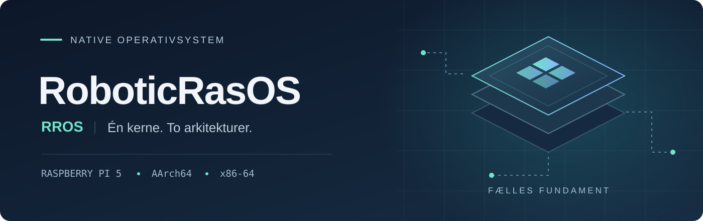
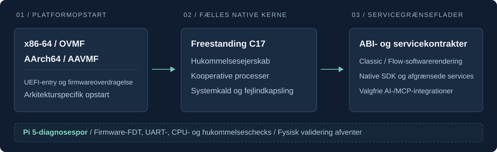

  

<h3 align="center">Designet til robotteknologi, AI og generel databehandling.</h3>

  
  
  
  

  
  

  <a href="#selvstændigt-udviklet">Overblik</a> &nbsp;·&nbsp;
  <a href="#arkitektur">Arkitektur</a> &nbsp;·&nbsp;
  <a href="#scenarier">Scenarier</a> &nbsp;·&nbsp;
  <a href="#målplatforme">Platforme</a> &nbsp;·&nbsp;
  <a href="#dokumentation">Dokumentation</a> &nbsp;·&nbsp;
  <a href="README.md">English</a> / <strong>Dansk</strong>

**RoboticRasOS (RROS)** er et selvstændigt udviklet native operativsystem
designet til robotteknologi, AI-applikationer og generel databehandling med
Raspberry Pi 5 (AArch64) og x86-64 som målplatforme. En fælles C17-kerne og afgrænsede
grænseflader giver et fælles fundament på tværs af arkitekturmål.
Linux og Windows er udviklingsværter, ikke runtime-kerner.

[Udviklingspakker og byggevejledning](docs/community/RELEASE.md) ·
[Fællesskabets diskussioner](https://github.com/Janus5G/RROS/discussions)

---

## Selvstændigt udviklet

RROS kombinerer sin egen native kerne, fælles grænseflader og
arkitekturspecifik opstart. Eksplicit ressourceejerskab, afgrænsede
servicekontrakter og reproducerbar udvikling forbinder firmware,
platformservices og applikationer på tværs af to arkitekturer.

| Fundament | Aktuelt arbejde |
|---|---|
| **Native kerne** | Hukommelsesejerskab, kooperative processer, afgrænsede systemkald og test af fejlindkapsling |
| **Applikationsfundament** | Classic- og Flow-shellfixtures, applikationslivscyklus og SDK-/ABI-checks |
| **Platformgrænseflader** | Firmware-/FDT-discovery og eksplicit MMIO-/DMA-ressourceejerskab |
| **Intelligente services** | Lokale inference-fixtures og afgrænsede, rettighedsstyrede AI-/MCP-servicegrænseflader |

## Arkitektur

Fælles grænseflader adskiller platformspecifik opstart fra kernen.
Se komponenternes ansvar og implementeringsstatus i den
[tekniske arkitektur](docs/ARCHITECTURE.md).

## Scenarier

| Retning | Tiltænkt anvendelse |
|---|---|
| **Robotteknologi og indlejret styring** | Native fundament til afgrænsede enhedsgrænseflader, styringsapplikationer og operatørarbejdsområder |
| **Lokal AI** | Inference og rettighedsstyret assistance, hvor forslag holdes adskilt fra privilegerede handlinger |
| **To arkitekturmål** | Raspberry Pi 5 som deploymentsretning og x86-64 som ledsagende udviklingsplatform |
| **RoboForge-kontekst** | Fremtidig opt-in-integration gennem eksisterende afgrænsede kompatibilitetskontrakter |

Dette er tiltænkte anvendelser, ikke påstande om fuld enhedsunderstøttelse eller
produktionsklar robotintegration.

## Målplatforme

| Platform | Rolle | Aktuelt omfang |
|---|---|---|
| **Raspberry Pi 5 Model B · 4 / 8 GB** | Primært AArch64-mål | Fysisk opstart og periferiudstyr afventer validering |
| **x86-64 · QEMU / OVMF** | UEFI-udvikling og regressionstest | Softwaretest i virtuelle gæster |
| **AArch64 · QEMU / AAVMF** | Regressionstest af fælles kerne og diagnostik | Generisk virtuel platform, ikke Pi 5-emulering |

Kortrevisioner, firmwarekrav og periferiudstyrets status beskrives i
[kompatibilitetsmatrixen](HARDWARE_COMPATIBILITY_MATRIX.md).

## Projektstatus

| Område | Verificeret omfang |
|---|---|
| **Software-CI** | Live workflowstatus for `main` ovenfor: Release validation omfatter CR-01–CR-07; Native ARM64 software tests kører værtsregressionstest og sanitizers |
| **Hardware** | Fysisk Raspberry Pi 5-opstart og periferiudstyr er fortsat ikke verificeret; QEMU er ikke kortverificering |
| **Tilgængelighed** | Privat pre-release-review; fuld releaseaccept udestår, og ingen offentlig release er godkendt |

GitHub Actions-badges viser status for hele workflows, ikke individuelle
jobresultater eller certificering af en komplet release. CLI-udløste kørsler
på `main` medtages uden filtrering efter event. Åbn de linkede workflowkørsler
for hvert CR-fund og autoritativ status: i kø, under kørsel eller afsluttet;
GitHub kan cache badgebilleder, som kræver adgang til det private repository.
Ingen af de to workflows verificerer fysisk Raspberry Pi 5-hardware.
Nogle skrivebords-,
driver-, netværks- og AI-stier er fortsat implementeringer på fixtureniveau.
Detaljerede procedurer og evidens findes i
[testvejledningen](docs/release/TESTING.md); se også
[implementeringsbegrænsningerne](docs/KNOWN_LIMITATIONS.md).

## Dokumentation

| Begynd her | Læs videre |
|---|---|
| [Byggemiljø](docs/TOOLCHAIN.md) | [Arkitektur og grænseflader](docs/ARCHITECTURE.md) |
| [Test og evidens](docs/release/TESTING.md) | [Implementeringsomfang](docs/KNOWN_LIMITATIONS.md) |
| [Bidragsvejledning](CONTRIBUTING.md) | [Sikkerhedspolitik](SECURITY.md) |
| [Licensinventar](docs/LICENSE_INVENTORY.md) | [Tredjepartsnoter](THIRD_PARTY_NOTICES.md) |

## Bidrag

Fokuserede ændringer og reproducerbare observationer styrker projektet.
Brug [bidragsvejledningen](CONTRIBUTING.md) under det aktuelle private review,
med små, afgrænsede forbedringer og reproducerbar softwareevidens.
Sikkerhedsproblemer følger [sikkerhedspolitikken](SECURITY.md).

## Licens og ophav

Projektejet RROS-software angivet i
[manifestet over ejede filer](docs/license-owned-files.json) er
**[GPL-3.0-or-later](LICENSE)**. Tredjepartsmateriale beholder egne vilkår;
se [komponentvist licensinventar](docs/LICENSE_INVENTORY.md)
og [attributionsnoter](THIRD_PARTY_NOTICES.md). Clearance til
firmwarevideredistribution er stadig uafklaret.

Banneret og arkitekturillustrationerne er originale projektillustrationer,
ikke skærmbilleder fra systemet eller hardwarefotografier. Verificerede
skrivebordsoptagelser og fysiske demonstrationsmedier foreligger endnu ikke.

---

  <strong>RoboticRasOS (RROS)</strong> 
  Native systemer · Robotteknologi · Intelligent computing

