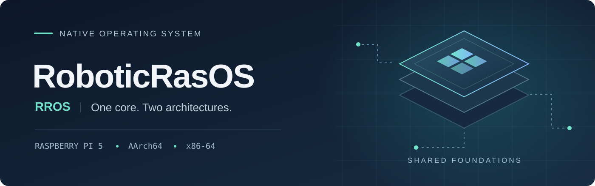
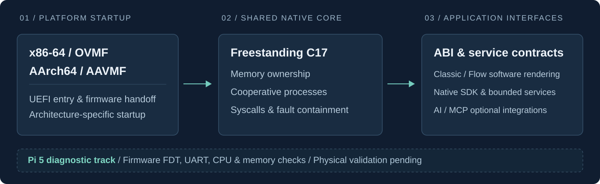

  

<h3 align="center">Designed for robotics, AI and general-purpose computing.</h3>

  
  
  
  

  
  

  <a href="#independent-by-design">Overview</a> &nbsp;·&nbsp;
  <a href="#architecture">Architecture</a> &nbsp;·&nbsp;
  <a href="#scenarios">Scenarios</a> &nbsp;·&nbsp;
  <a href="#platform-targets">Platforms</a> &nbsp;·&nbsp;
  <a href="#documentation">Documentation</a> &nbsp;·&nbsp;
  <strong>English</strong> / <a href="README.da.md">Dansk</a>

**RoboticRasOS (RROS)** is an independently developed native operating system
designed for robotics, AI applications and general-purpose computing, targeting
Raspberry Pi 5 (AArch64) and x86-64. A shared C17 core and bounded interfaces
provide a common foundation across architecture targets. Linux and Windows
are development hosts, not runtime kernels.

[Development downloads & build guide](docs/community/RELEASE.md) ·
[Community discussions](https://github.com/Janus5G/RROS/discussions)

---

## Independent by design

RROS combines its own native core, shared interfaces and architecture-specific
startup. Explicit resource ownership, bounded service contracts and
reproducible development connect firmware, platform services and applications
across two architectures.

| Foundation | Current work |
|---|---|
| **Native core** | Memory ownership, cooperative processes, bounded syscalls and fault-containment tests |
| **Application foundation** | Classic and Flow shell fixtures, application lifecycle and SDK/ABI checks |
| **Platform interfaces** | Firmware/FDT discovery and explicit MMIO/DMA resource ownership |
| **Intelligent services** | Local inference fixtures and bounded, permission-controlled AI/MCP service interfaces |

## Architecture

Shared interfaces keep platform-specific startup separate from the core.
Explore component responsibilities and implementation status in the
[technical architecture](docs/ARCHITECTURE.md).

## Scenarios

| Direction | Intended use |
|---|---|
| **Robotics & embedded control** | A native foundation for bounded device interfaces, control applications and operator workspaces |
| **Local AI** | Inference and permission-controlled assistance, with proposals kept separate from privileged actions |
| **Two architecture targets** | Raspberry Pi 5 deployment direction and an x86-64 companion development platform |
| **RoboForge context** | Future opt-in integration through the existing bounded compatibility contracts |

These are intended uses, not claims of complete device support or
production robotics integration.

## Platform targets

| Target | Role | Current scope |
|---|---|---|
| **Raspberry Pi 5 Model B · 4 / 8 GB** | Primary AArch64 target | Physical boot and peripheral validation pending |
| **x86-64 · QEMU / OVMF** | UEFI development and regression platform | Software guest testing |
| **AArch64 · QEMU / AAVMF** | Shared-core and diagnostic regression platform | Generic virtual platform, not Pi 5 emulation |

Board revisions, firmware requirements and peripheral readiness are detailed
in the [compatibility matrix](HARDWARE_COMPATIBILITY_MATRIX.md).

## Project status

| Area | Verified scope |
|---|---|
| **Software CI** | Live `main` workflow status above: Release validation includes CR-01–CR-07; Native ARM64 software tests runs host regressions and sanitizers |
| **Hardware** | Physical Raspberry Pi 5 boot and peripheral operation remain unverified; QEMU is not board verification |
| **Availability** | Private pre-release review; complete release acceptance remains outstanding and no public release is approved |

The GitHub Actions badges report whole-workflow status, not individual job
results or full-release certification. They include CLI-triggered runs on
`main` without filtering by event. Open the linked workflow runs for each
CR finding and authoritative queued, running or completed status; badge
images can be cached by GitHub and require private-repository access.
Neither workflow verifies physical Raspberry Pi 5 hardware.
Some desktop, driver, networking and AI paths
remain fixture-level implementations. Detailed procedures and evidence belong
in the [testing guide](docs/release/TESTING.md); see also the
[implementation limitations](docs/KNOWN_LIMITATIONS.md).

## Documentation

| Start here | Explore further |
|---|---|
| [Build environment](docs/TOOLCHAIN.md) | [Architecture & interfaces](docs/ARCHITECTURE.md) |
| [Testing & evidence](docs/release/TESTING.md) | [Implementation scope](docs/KNOWN_LIMITATIONS.md) |
| [Contribution guide](CONTRIBUTING.md) | [Security policy](SECURITY.md) |
| [License inventory](docs/LICENSE_INVENTORY.md) | [Third-party notices](THIRD_PARTY_NOTICES.md) |

## Contribute

Focused changes and reproducible observations make the project stronger.
For the current private review, use the [contribution guide](CONTRIBUTING.md)
with small, well-scoped improvements and reproducible software evidence.
Security concerns follow the [security policy](SECURITY.md).

## License & provenance

Project-owned RROS software identified in the
[owned-file manifest](docs/license-owned-files.json) is
**[GPL-3.0-or-later](LICENSE)**. Third-party materials retain their own terms;
see the [component license inventory](docs/LICENSE_INVENTORY.md)
and [attribution notes](THIRD_PARTY_NOTICES.md). Firmware redistribution
clearance remains incomplete.

The banner and architecture artwork are original project illustrations,
not runtime screenshots or hardware photographs. Verified desktop captures
and physical demonstration media are not yet available.

---

  <strong>RoboticRasOS (RROS)</strong> 
  Native systems · Robotics · Intelligent computing

